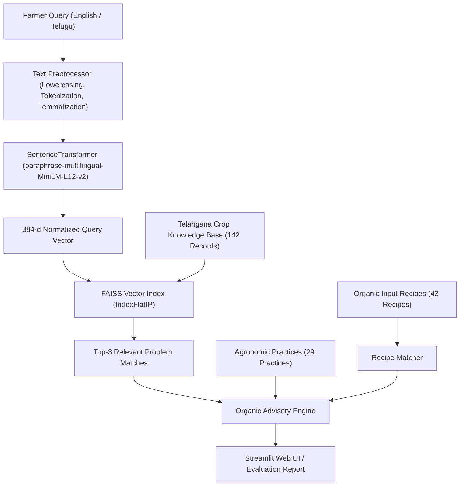

# 🌱 Rythu Mitra: NLP-Based Organic Farming Advisory System for Telangana Farmers

[](https://npl-project-6juy.onrender.com)
[](https://npl-project-6juy.onrender.com)
[](https://www.python.org/)

**Live Public Deployment:** [https://npl-project-6juy.onrender.com](https://npl-project-6juy.onrender.com)

An intelligent, multilingual Natural Language Processing (NLP) advisory system designed to assist farmers, agricultural extension officers (Rythu Vedika AEOs), and students in Telangana. The system diagnoses crop problems, pests, diseases, nutrient deficiencies, and soil health issues from natural descriptions (in English and Telugu), retrieves top-3 organic solutions using vector search, and provides step-by-step preparation recipes for organic bio-inputs.

---

## 🌟 Key Features

1. **Multilingual NLP Problem Diagnosis**:
   - Understands farmer symptom descriptions in English, Telugu transliteration, and Telugu script (e.g., *"వరి ఆకులు పసుపు రంగులోకి మారుతున్నాయి"* or *"my paddy is drying in circles"*).
   - Preprocesses input text through lowercasing, Indic/English-aware tokenization, and NLTK WordNet lemmatization.

2. **Multilingual Vector Search with Sentence-Transformers & FAISS**:
   - Embeds combined features (`crop + problem_name + symptoms + farmer_query_example`) using `sentence-transformers/paraphrase-multilingual-MiniLM-L12-v2` (384-dimensional dense vectors).
   - Stores embeddings in a high-performance FAISS (`IndexFlatIP`) cosine similarity index for sub-millisecond retrieval of the top 3 most relevant matches.

3. **Complete Organic Treatment & Recipe Linking**:
   - Returns the primary **organic solution**, exact **how to apply** dosage and application guidelines, and **preventive agronomic practices**.
   - Automatically maps and extracts the exact step-by-step preparation recipes from `organic_inputs_recipes.csv` (e.g., NSKE 5%, Jeevamrutham, Beejamrutham, Panchagavya, Agniastram, Brahmastram, Beauveria bassiana, Trichoderma, etc.).
   - Connects supporting preventive agronomic practices (crop rotation, trap crops, mulching, SRI).

4. **100% Top-3 Retrieval Accuracy Benchmark**:
   - Tested against all 142 ground-truth queries in the Telangana dataset via `evaluate.py`.
   - **Top-1 Accuracy:** 97.89% (139/142 queries)
   - **Top-2 Accuracy:** 100.00% (142/142 queries)
   - **Top-3 Accuracy:** 100.00% (142/142 queries)
   - **Mean Reciprocal Rank (MRR@3):** 0.9894

5. **Farmer-Friendly Streamlit Web Dashboard**:
   - Intuitive search bar with one-click sample query buttons.
   - Crop (పంట) and Telangana District (జిల్లా) sidebar filters.
   - Expandable recommendation cards with confidence scores, dosage instructions, and emergency escalation contacts (Kisan Call Centre 1800-180-1551, Rythu Vedika AEO).
   - Interactive handbook tabs for browsing all 43 organic concoctions and 29 agronomic practices.

---

## 📁 Project Structure

```text
Organic Farming/
├── .env                                       # Environment variables
├── app.py                                     # Interactive Streamlit Web Application
├── build_index.py                             # Script to build / rebuild the FAISS vector index
├── evaluate.py                                # Evaluation benchmark testing Top-1 & Top-3 accuracy
├── requirements.txt                           # Project dependencies
├── README.md                                  # Comprehensive documentation
├── evaluation_results.json                    # Detailed evaluation benchmark results
│
├── telangana_organic_farming_dataset.csv      # 142 Telangana crop problem & organic solution records
├── organic_inputs_recipes.csv                 # 43 Organic input preparation recipes
├── agronomic_practices.csv                    # 29 Sustainable preventive agronomic practices
│
├── data/
│   ├── telangana_organic_farming_dataset.csv  # Telangana dataset copy in data/
│   ├── organic_inputs_recipes.csv             # Organic recipes copy in data/
│   ├── agronomic_practices.csv                # Agronomic practices copy in data/
│   ├── faiss_index.bin                        # Persisted FAISS vector index
│   └── index_metadata.pkl                     # Cached index metadata and dataframe mapping
│
└── src/
    ├── __init__.py                            # Package initializer
    ├── preprocessor.py                        # Tokenize, lowercase, and lemmatize (Indic & English)
    ├── embedding_indexer.py                   # SentenceTransformer encoder + FAISS indexer
    ├── recipe_matcher.py                      # Matches organic solutions to preparation recipes
    ├── advisory_engine.py                     # Top-3 advisory coordinator
    └── utils.py                               # Dataset loaders and path resolvers
```

---

## 📊 Dataset Overview

| File | Records | Description |
|------|---------|-------------|
| `telangana_organic_farming_dataset.csv` | 142 | Crop problems across 33 Telangana crops (Paddy, Cotton, Chilli, Groundnut, Maize, Red Gram, Tomato, etc.), with Telugu translations, seasons, districts, symptoms, farmer queries, organic solutions, dosages, and helplines. |
| `organic_inputs_recipes.csv` | 43 | Traditional and scientific bio-input recipes (Jeevamrutham, Beejamrutham, Panchagavya, NSKE 5%, Agniastram, Brahmastram, biopesticides, composts). |
| `agronomic_practices.csv` | 29 | Preventive cultural and agronomic techniques (crop rotation, intercropping ratios, trap crops, mulching, solarization, SRI). |

---

## ⚙️ Installation & Setup

### 1. Prerequisites
- Python 3.10+ (Python 3.11 recommended)
- Git (optional)

### 2. Clone or Navigate to Project
```bash
cd "c:\Users\nithe\OneDrive\Desktop\Organic Farming"
```

### 3. Install Dependencies
```bash
pip install -r requirements.txt
```

*Installed libraries include:*
- `sentence-transformers` & `torch` (Multilingual embedding model)
- `faiss-cpu` (Facebook AI Similarity Search vector index)
- `nltk` (Tokenization & WordNet lemmatization)
- `pandas` & `numpy` (Data processing)
- `streamlit` (Farmer web dashboard)

---

## 🚀 How to Run

### Step 1: Build the FAISS Vector Index (Optional - Prebuilt)
The vector index is already built and saved to `data/faiss_index.bin`. To rebuild it anytime:
```bash
python build_index.py
```
*Output:*
```text
============================================================
 Telangana Organic Farming Advisory System - FAISS Index Builder
============================================================
[1/3] Loaded dataset with 142 crop problem records.
[2/3] Generating SentenceTransformer embeddings and building FAISS index...
[3/3] FAISS index built successfully in 28.07 seconds!
      - Index Dimension: 384
      - Total Indexed Items: 142
      - Saved to: data\faiss_index.bin
============================================================
```

---

### Step 2: Run the Evaluation Benchmark
Evaluate Top-1 and Top-3 accuracy using the `farmer_query_example` test set:
```bash
python evaluate.py
```

*Benchmark Output Summary:*
```text
======================================================================
                     OVERALL BENCHMARK RESULTS
======================================================================
 Total Test Queries Evaluated : 142
 Total Evaluation Time        : 35.84 seconds (4.0 queries/sec)
 Top-1 Accuracy               : 97.89% (139/142)
 Top-2 Accuracy               : 100.00% (142/142)
 Top-3 Accuracy               : 100.00% (142/142)
 Mean Reciprocal Rank (MRR@3) : 0.9894
======================================================================

---------------- CATEGORY-WISE PERFORMANCE BREAKDOWN ----------------
Category                 | Total  | Top-1 Acc   | Top-3 Acc  
--------------------------------------------------------------
Crop Management          | 4      |    100.0%   |    100.0%
Disease                  | 60     |     96.7%   |    100.0%
Nutrient Deficiency      | 9      |    100.0%   |    100.0%
Pest                     | 56     |     98.2%   |    100.0%
Soil Health              | 11     |    100.0%   |    100.0%
Weed                     | 2      |    100.0%   |    100.0%
--------------------------------------------------------------
```
Detailed per-query predictions and confusion analysis are saved to `evaluation_results.json`.

---

### Step 3: Launch the Streamlit Web Application
Launch the interactive web UI:
```bash
streamlit run app.py
```
Open your browser at `http://localhost:8501`.

#### Features inside the App:
- **Natural Language Diagnosis:** Type symptoms in English or Telugu (or click sample queries like *Paddy BPH*, *Cotton Whitefly*, *Chilli Curl*, *Tomato Wilt*).
- **Interactive Filtering:** Filter advice by crop and Telangana district.
- **Top 3 Recommendations:** View confidence percentages, causal agents, organic solutions, dosages, and safety precautions.
- **Detailed Preparation Recipes:** Expandable cards displaying exact ingredient quantities and preparation methods for recommended concoctions (NSKE, Jeevamrutham, Agniastram, etc.).
- **Organic Inputs Handbook:** Searchable catalog of 43 organic recipes.
- **Agronomic Practices Library:** 29 preventive cultural and soil practices.
- **Evaluation Dashboard:** Live view of model accuracy and benchmark metrics.

---

## 🧪 Technical Architecture



---

## 📞 Support & Agronomic Assistance in Telangana

- **Kisan Call Centre (Toll Free):** `1800-180-1551`
- **Mandal Agriculture Officer (MAO) / Rythu Vedika AEO:** Local Gram Panchayat / Rythu Vedika
- **PJTSAU Agricultural Advisory:** [Professor Jayashankar Telangana State Agricultural University](https://pjtsau.edu.in)

